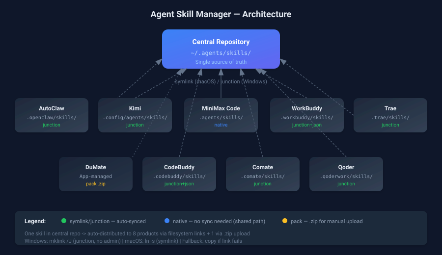
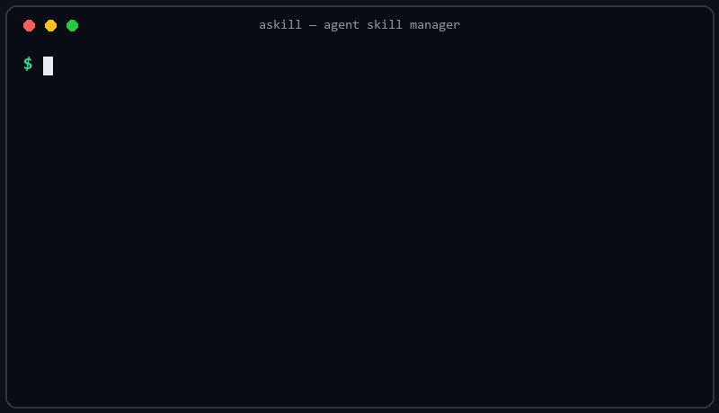

<div align="center">


# Agent Skill Manager

[English](README.en.md) | [简体中文](README.md)

> **Package name ≠ repo name (note)**: the PyPI package is **`cn-skill-sync`** while the GitHub repo is **`agent-skill-manager`** — i.e. "install `cn-skill-sync`, source lives in `agent-skill-manager`". Every `pip install` below uses `cn-skill-sync`.
>
> ⚠️ **Do not `pip install askill`** — the `askill` package on PyPI is an unrelated project. Install with `pip install cn-skill-sync`; the command it provides is called `askill`.

[](https://github.com/yxdwind/agent-skill-manager/actions/workflows/ci.yml) [](tests/)
[](https://skills.sh/yxdwind/agent-skill-manager)
[](https://www.python.org/)
[](https://github.com/yxdwind/agent-skill-manager)
[](LICENSE)
[](#supported-products)

**Write once, sync everywhere** — Cross-platform skill management for 15 domestic Chinese AI agent products.

[Install](#install) · [Usage](#usage) · [Security Audit](#security-audit) · [Architecture](#architecture)

</div>

---

## The Problem

Every Chinese AI agent product keeps its skills in its own directory. Developing one skill means manually copying it to every product:

```
~/.openclaw-autoclaw/skills/my-skill/  <- AutoClaw2
~/.config/agents/skills/my-skill/     <- Kimi
~/.workbuddy/skills/my-skill/         <- WorkBuddy
~/.trae-cn/skills/my-skill/           <- Trae CN
~/.codebuddy/skills/my-skill/         <- CodeBuddy
~/.comate/skills/my-skill/            <- Comate
~/.qoder-cn/skills/my-skill/          <- Qoder CN
... and again, every time you change it
```

**agent-skill-manager** solves this with a central repository + one-command distribution: edit once, sync everywhere.

## Supported Products (15)

| Product | Company | macOS Path | Windows Path | Linux Path | Sync Method |
|---------|---------|-----------|--------------|------------|-------------|
| AutoClaw2 | Zhipu | `~/.openclaw-autoclaw/skills/` | `%USERPROFILE%\.openclaw-autoclaw\skills\` | same as macOS | symlink/junction |
| Kimi | Moonshot AI | `~/.config/agents/skills/` | `%USERPROFILE%\.config\agents\skills\` | same as macOS | symlink/junction |
| MiniMax Code | MiniMax | `~/.agents/skills/` | `%USERPROFILE%\.agents\skills\` | same as macOS | native |
| WorkBuddy | Tencent | `~/.workbuddy/skills/` | `%USERPROFILE%\.workbuddy\skills\` | — | symlink + settings.json |
| Trae | ByteDance | `~/.trae/skills/` | `%USERPROFILE%\.trae\skills\` | — | symlink/junction |
| Trae CN | ByteDance | `~/.trae-cn/skills/` | `%USERPROFILE%\.trae-cn\skills\` | — | symlink/junction |
| TRAE SOLO CN | ByteDance | `~/.trae-cn/skills/` (shared with Trae CN) | `%USERPROFILE%\.trae-cn\skills\` | — | symlink/junction |
| DuMate | Baidu | App-managed | App-managed | App-managed (.zip pack works) | pack .zip upload |
| CodeBuddy | Tencent | `~/.codebuddy/skills/` | `%USERPROFILE%\.codebuddy\skills\` | same as macOS | symlink + settings.json |
| Comate / Wenxin Kuaima | Baidu | `~/.comate/skills/` | `%USERPROFILE%\.comate\skills\` | same as macOS | symlink/junction |
| Qoder CN | Alibaba | `~/.qoder-cn/skills/` | `%USERPROFILE%\.qoder-cn\skills\` | — | symlink/junction |
| Qoder CN IDE | Alibaba | `~/.qoder-cn/skills/` (shared with Qoder CN) | `%USERPROFILE%\.qoder-cn\skills\` | — | symlink/junction |
| QwenWork / Qianwen Office | Alibaba | `~/.qwenworkcn/skills/` | `%USERPROFILE%\.qwenworkcn\skills\` | — | symlink/junction |
| DoubaoWork | ByteDance | `~/.super_doubao/super-doubao-runtime/workspace/.user_skills/` | `%LOCALAPPDATA%\DoubaoWork\User Data\Default\.doubaowork\agent_mode\workspace\.user_skills\` | — | symlink/junction |
| ZCode | ZCode | `~/.zcode/skills/` | `%USERPROFILE%\.zcode\skills\` | same as macOS | symlink/junction |

> **Linux support (v0.10.0)**: CLI-based products (AutoClaw2, Kimi, MiniMax Code, CodeBuddy, Comate, ZCode) use the same dotdir convention + native symlinks on Linux; DuMate's .zip pack works everywhere. Desktop/IDE apps without a Linux build are skipped automatically (`askill products` shows N/A) - add a `linux_path` when a build ships.

> **Full capability matrix (v0.13.0)**: the per-product audit of paths / sync methods / settings switches / frontmatter requirements / command support lives in [docs/product-matrix.md](docs/product-matrix.md).

## How It Works



**Core design**: the central repository `~/.agents/skills/` is the single source of truth. Skills are distributed to all products via symlinks (macOS/Linux) or junctions (Windows). For DuMate, which does not expose a filesystem, skills are packed as .zip for manual upload. QwenWork and DoubaoWork are synced the same way via junctions.

- **Windows**: junction via `mklink /J`, no admin rights needed
- **macOS / Linux**: symlink via `ln -s`
- **Automatic fallback**: falls back to copying if link creation fails
- **Conflict protection (v0.13.0)**: if a product's skills dir already holds a same-named *real* directory that differs from the central repo, sync skips it with a warning (`--force` overrides) - your hand-maintained skills are never silently clobbered
- **Zero dependencies**: Python standard library only



## Install

```bash
# Install from PyPI (recommended)
pip install cn-skill-sync

# Development install
cd agent-skill-manager
pip install -e .

# If pip hits TLS certificate issues
python -m pip install -e . --no-build-isolation
```

After installation, the `askill` command is available globally.

You can also install the skill definition through the `npx skills` ecosystem:

```bash
npx skills add yxdwind/agent-skill-manager
```

## Usage

```bash
# Show installation status across products (with security audit score column)
askill status

# Sync all skills to all products
askill sync

# Sync a specific skill
askill sync my-skill

# v0.13.0 conflict protection: a same-named real directory (not a link) in a
# product's skills dir is never silently overwritten - sync skips it with a
# hint. Pass --force once you have confirmed the overwrite.
askill sync my-skill --force

# v0.17.0 settings.json lock warning: if the target product's IDE is running and
# holds settings.json open (common on Windows, raised as WinError 5 / Access Denied),
# the link is still created but sync now prints a prominent aggregated warning at the
# end listing the "linked but NOT enabled" products and what to do
# (close/restart that IDE, then re-run askill sync to actually enable the skill).

# List all skills in the central repository (with audit scores)
askill list

# Install a skill (local path / GitHub URL / skills.sh shorthand)
# since v0.12.0: spec + security checks run by default, risky/dangerous warns loudly
# since v0.13.0: also checks per-product frontmatter requirements (e.g. QwenWork needs description_zh)
askill install /path/to/skill-folder
askill install --sync /path/to/skill-folder          # auto-sync after install
askill install --audit /path/to/skill-folder         # print the full audit report
askill install --no-audit /path/to/skill-folder      # skip the default checks
askill install --sync --audit <github-url>           # sync + full audit together

# skills.sh ecosystem shorthand (v0.11.0, same syntax as npx skills)
askill search pdf                                    # search the skills.sh registry
askill search pdf --install 1                        # search and install result #1
askill install anthropics/skills                     # owner/repo shorthand
askill install anthropics/skills@pdf                 # one skill inside a repo
askill install https://skills.sh/anthropics/skills/pdf   # skills.sh page URL

# Multiple GitHub URL formats are supported (default branch auto-detected)
askill install --sync https://github.com/user/repo                                # repo root SKILL.md
askill install --sync https://github.com/user/repo/tree/main/my-skill             # subdirectory on a branch
askill install --sync https://github.com/user/repo/blob/main/my-skill/SKILL.md    # direct SKILL.md link

# Adopt skills from one platform into the central repo and sync everywhere
askill adopt autoclaw my-skill                       # adopt one skill from AutoClaw
askill adopt kimi                                    # adopt all skills from Kimi

# Static security audit: prompt injection / dangerous code / secrets / binaries
askill audit                                         # audit all skills
askill audit my-skill                                # audit one skill

# Live watch: auto-sync on every skill change (event-driven since v0.10.0)
askill watch                                         # watch ~/.agents/skills/ (native fs events)
askill watch --interval 5                            # fallback poll interval (s)

# Skill upgrades: GitHub-origin tracking + one-command update (v0.8.0)
askill update --check                                # list available updates
askill update my-skill                               # update one skill & sync
askill update                                        # update all tracked skills

# Remove a skill from all products
askill remove my-skill

# Pack a skill as .zip for DuMate
askill pack my-skill

# Create & publish (v0.15.0): scaffold + one-command publish back to GitHub
askill new my-skill --target qwenwork              # scaffold: frontmatter prefilled per product
askill publish my-skill --repo owner/name          # gates + dry run (--push to publish)

# Drift detection (v0.16.0): product-dir skills diverging from central (new / differs)
askill drift [product]

# List all supported products
askill products
```

**Exit codes (since v0.16.0)**: `0` success (incl. dry runs / empty results) - `1` operational failure (install/verify/publish could not do its job) - `2` usage error. Scripts can rely on exit codes, paired with `--json` for fully machine-readable output.

### Typical Workflow

```
1. askill status          <- check installation status
2. edit ~/.agents/skills/my-skill/SKILL.md
3. askill sync my-skill   <- distribute to all 15 products
4. askill pack my-skill   <- .zip for DuMate
```

### Create & Publish (v0.15.0)

```
1. askill new my-skill --target qwenwork      # scaffold: frontmatter prefilled per product
2. askill publish my-skill --repo owner/name  # gates + dry run (--push to publish)
```

Published skills are installable via `askill install owner/repo@skill` and `npx skills add`; skills.sh lists and ranks them automatically as installs happen. Live example: the official skills repo [yxdwind/skills](https://github.com/yxdwind/skills) (skill-doctor / sync-troubleshoot, install with `askill install yxdwind/skills@skill-doctor`).

## Project Structure

```
agent-skill-manager/
├── pyproject.toml              # PEP 621 project config
├── setup.py                    # setuptools compatibility entry
├── docs/
│   ├── architecture.svg        # architecture diagram
│   ├── demo.gif                # animated terminal demo
│   ├── social-preview.png      # social share card (GitHub social preview)
│   ├── product-paths.md        # per-product path reference
│   └── product-matrix.md       # product capability matrix (v0.13.0 baseline)
├── src/                        # package root (mapped as agent_skill_manager)
│   ├── __init__.py / __main__.py
│   ├── config/products.py      # 15 product definitions (paths / sync method /
│   │                           # settings / shared dirs / frontmatter needs, declarative)
│   ├── controllers/cli.py      # CLI commands (17 commands)
│   ├── models/                 # TypedDict data shapes
│   ├── services/               # business logic (sync / audit / watch / sources
│   │                           #             / registry / spec / welcome (first-run))
│   └── utils/                  # filesystem.py (cross-platform file ops)
│                               # watcher.py (native fs events: inotify/kqueue/ReadDirectoryChangesW)
├── .github/ISSUE_TEMPLATE/     # new-product support request (user files it, supported within a week)
└── tests/                      # 309 tests
    ├── test_products.py
    ├── test_utils.py
    ├── test_core.py
    ├── test_adopt.py
    ├── test_security.py
    ├── test_cli.py
    ├── test_cli_flags.py
    ├── test_drift.py
    ├── test_new.py
    ├── test_publish.py
    ├── test_watch.py
    ├── test_watcher.py
    ├── test_welcome.py         # first-run banner (once only / silent in quiet+json)
    ├── test_registry.py
    ├── test_spec.py
    └── test_matrix.py          # cross-product consistency regression lock (v0.13.0)
```

## Watch & Update (v0.8.0 / v0.10.0)

### askill watch — save and it's synced (event-driven since v0.10.0)

`askill watch` keeps watching the central repository, idling on **native OS file events** with zero third-party dependencies:

- **Event-driven**: inotify on Linux, kqueue on macOS, ReadDirectoryChangesW on Windows (all stdlib ctypes/select); saves are sensed instantly - ~0.4s observed latency including debounce, no more fixed 3s polling
- **Debounced**: the multiple syscalls behind one editor save collapse into a single sync; only skills that truly changed are re-synced
- **Full reconciliation**: even in event mode a snapshot rescan runs every 30s as a safety net against lost events (queue overflow, directory swaps, root recreation)
- **New/changed skill** → synced to all products immediately, per-product results printed live
- **Conflict/pack hints (v0.13.0)** → when a product dir holds a conflicting real directory the local copy is kept and a resolution hint is printed; pack-mode products (DuMate) get a hint to refresh the zip via `askill pack`
- **Deleted skill** → leftover links are cleaned from every product, no dead links (root deletion is sensed too)
- **Security re-check** → audit re-runs after every sync; a verdict drop from safe to risky/dangerous warns loudly with the top findings
- **Automatic fallback** → if native events are unavailable (restricted kernel) or the backend dies mid-run, it degrades to polling (`--interval`, default 3s) without ever stopping the watch

### askill update — origin tracking and one-command upgrades

Skills installed from a GitHub URL record their origin (repo / path / branch / commit) in `~/.agents/skills/.askill-sources.json`:

```bash
askill update --check      # list skills with a newer version upstream
askill update              # check and apply all updates (auto-sync + re-audit after)
askill update my-skill     # only this skill
```

## skills.sh Ecosystem (v0.11.0)

[skills.sh](https://skills.sh) (by Vercel Labs) is the de-facto registry of the open Agent Skills ecosystem ([agentskills.io](https://agentskills.io) specification). askill integrates in three directions, all stdlib-only (urllib):

**① Consume** - install any skill from the registry, no Node.js required:

```bash
askill search pdf                        # search the registry (name / source / installs)
askill search pdf --install 1            # install result #1 directly
askill install anthropics/skills@pdf     # shorthand, same syntax as npx skills add
askill install https://skills.sh/anthropics/skills/pdf   # pasted page URLs work too
```

**② Publish** - the central repo `~/.agents/skills/` already uses the canonical layout (one directory with a SKILL.md per skill). Push it to GitHub and it can be indexed by skills.sh and read by every spec-compliant agent:

```bash
askill verify            # check against the agentskills.io spec (name/description/limits/dir match)
askill verify my-skill   # one skill; errors block indexing, warnings are advisory (e.g. body > 500 lines)
```

Since v0.13.0 verify also appends **per-product frontmatter requirements** (e.g. QwenWork needs `name`+`version`+`description`+`description_zh`); missing fields are listed per product, and `askill install` warns too - no more "installed but the product won't load it" surprises.

**③ Bridge** - skills installed via `npx skills add -g <repo>` into product directories can be pulled into the central repo and distributed to all domestic products:

```bash
npx skills add -g anthropics/skills      # install with the skills CLI first
askill adopt all                          # scan every product dir, adopt + distribute to 15 products
```

## Security Audit

`askill audit` runs a **zero-dependency static analysis** on skills. It starts at 100 points and deducts by severity (capped at 40 per category for danger/high, capped at 10 per category for benign low findings):

| Dimension | Severity | Examples |
|-----------|----------|----------|
| Prompt injection | critical | "ignore all previous instructions", safety bypass language |
| Dangerous code | critical/high | `curl \| sh`, `rm -rf /`, `exec()`, `shell=True` |
| Secrets & exfiltration | high/medium | reading `~/.ssh`, hardcoded API keys, webhook URLs |
| Binary files | high | bundled `.exe`/`.dll` executables |
| File integrity | high/medium | missing SKILL.md, oversized files, symlinks |

**Scoring & verdict**: A >= 90 (safe) - B >= 80 (safe) - C >= 70 (caution) - D >= 60 (risky) - F < 60 (dangerous)

**v0.17.0 audit precision improvements**:
- **Benign-noise cap**: benign low-severity hits (URLs, `.env` references, `child_process`) are capped at `_MINOR_CAP=10` per category, so they no longer saturate the cap and sink a harmless large skill to F.
- **Dev/test path downweighting**: findings inside `test/ tests/ bin/ scripts/ dev/ examples/ fixtures/ node_modules/ dist/ build/ docs/` are downweighted and tagged `(dev/test path - verify)` - kept for human review but not counted against the score. Toggle with the `ASKILL_AUDIT_DEV_MODE` env var: `downweight` (default) / `skip` / `off` (legacy, full count).
- **Tighter regexes**: `regex.exec()` is no longer mistaken for "dynamic code execution" (`child_process.exec` is still covered by the existing medium-severity rule); the credential rule no longer matches the bare word `credentials`, so defensive code that *rejects* credential-bearing URLs is no longer flagged as "reads sensitive credential files".

Scores also appear in `askill list` and `askill status` output. **Since v0.12.0 every `askill install` runs the spec + security checks by default** (plus per-product frontmatter checks since v0.13.0): clean installs print a one-line `[check]` summary, risky/dangerous verdicts warn loudly in any mode; `--audit` prints the full report, `--no-audit` skips:

```bash
askill install --sync --audit https://github.com/user/repo/tree/main/my-skill   # sync + full audit report
askill install --no-audit https://github.com/user/repo/tree/main/my-skill       # skip the default checks
```

## Extend It

### Add a New Product

Edit `src/config/products.py` and append to the `PRODUCTS` list:

```python
{
    "name": "New Product",
    "short": "short-name",
    "macos_path": HOME / ".newproduct" / "skills",
    "windows_path": HOME / ".newproduct" / "skills",
    "linux_path": HOME / ".newproduct" / "skills",  # omit (or None) if no Linux build
    "sync_method": "symlink",  # symlink | native | pack
    "note": "description",
    "extra_dirs_macos": [],
    "extra_dirs_windows": [],
    "extra_dirs_linux": [],
    # optional declarative fields since v0.13.0, fill in as applicable:
    # "settings_file": HOME / ".newproduct" / "settings.json",
    # "settings_mode": "skills-switch",           # settings.json has {"skills": {name: bool}}
    # "required_frontmatter": ["name", "version"],  # extra SKILL.md fields this product mandates
}
```

Once declared, sync/status/watch behavior, frontmatter validation and the consistency assertions in `tests/test_matrix.py` all cover the new product automatically - no other code changes needed.

The full onboarding flow (per-platform verification checklist and release steps) lives in [docs/onboarding-new-product.md](docs/onboarding-new-product.md) - the goal is supporting a new product within one week of its launch. Users can also file a [new-product support request](https://github.com/yxdwind/agent-skill-manager/issues/new?template=new-product-support.md) directly.

### Run Tests

```bash
pip install pytest
pytest tests/ -v
```

### Shell Completion (v0.13.0)

The project ships zero-dependency bash / zsh / fish completion scripts, available two ways:

- **From source (git clone)**: use the repo-root `completion/`:
  ```bash
  # bash
  source completion/askill.bash

  # zsh — drop into any directory in $fpath, then `compinit`
  cp completion/_askill ${fpath[1]}/_askill

  # fish
  cp completion/askill.fish ~/.config/fish/completions/
  ```
- **From PyPI (v0.18.1+)**: the wheel now bundles the scripts — locate them and source:
  ```bash
  COMPLETION_DIR="$(python -c 'import agent_skill_manager,os;print(os.path.join(os.path.dirname(agent_skill_manager.__file__),"completion"))')"
  source "$COMPLETION_DIR/askill.bash"
  ```

The skill / product short-name candidates are pulled live from
`askill list --quiet` / `askill products --json`, so newly installed skills
show up in your Tab completions immediately.

## Contributing

See [CONTRIBUTING.md](CONTRIBUTING.md). The project enforces Conventional
Commits (via commitizen) and requires `ruff check src tests` + `mypy src` +
`pytest tests -q` to be green locally before pushing - CI must agree.

## Related Projects

- [yxdwind/skills](https://github.com/yxdwind/skills) — official published skills (skill-doctor / sync-troubleshoot, `askill install yxdwind/skills@<skill>`; also a live example of askill publish)
- [manage-my-skills](https://github.com/hchcx/manage-my-skills) — cross-platform skill manager for 20+ international products
- [awesome-agent-skills](https://github.com/libukai/awesome-agent-skills) — the ultimate Agent Skills guide
- [skills CLI](https://www.npmjs.com/package/skills) — npm-based agent skills package manager
- [skill-creator](https://github.com/yxdwind/agent-skill-manager) — skill authoring reference

## Contributors

Thanks to the following contributor:

- [**@GLM-5.2**](https://github.com/zai-org) — AI co-developer (Zhipu GLM-5.2)

## Security & Privacy

- [Security Policy (SECURITY.md)](SECURITY.md) — vulnerability reporting & security guidance
- [Privacy Policy (PRIVACY.md)](PRIVACY.md) — local-first data handling

## Known Limitations

- **`sync` and `settings.json` lock**: on Windows, if the target product's IDE is running and holds its `settings.json` open (`WinError 5 / Access Denied`), `sync` still creates the skill link but cannot enable the skill inside that product. `sync` prints a prominent aggregated warning at the end listing the "linked but NOT enabled" products and how to fix it — **close / restart that IDE, then re-run `askill sync`** to actually enable the skill; don't assume the sync already took effect.
- **`watch` in restricted / container environments**: `watch` prefers native filesystem events (Linux inotify / macOS kqueue / Windows ReadDirectoryChangesW) and falls back to polling when unavailable. In some sandboxes / containers events may not be delivered, so it can look idle even though the polling fallback keeps watching; it runs normally in a native terminal.
- **`drift` cross-product scanning**: `drift` reads each product's directory under your home folder; in permission-restricted environments (some sandboxes) it can be interrupted by a security policy and must be run in a normally-privileged terminal.
- **`publish` gate**: by default the per-product frontmatter gate checks **every** product that declares extra fields. If you publish to only a subset, use `askill publish <skill> --repo owner/name --target <short> [--target ...]` to scope it down and avoid being blocked by an unrelated product's field requirement.
- **Security audit false positives**: `audit` down-weights code in development / test paths (e.g. `test/`, `bin/`), but it is still a static heuristic and may mis-flag code; treat high-severity findings as a prompt for manual review, not a verdict.

## License

[MIT](LICENSE)
